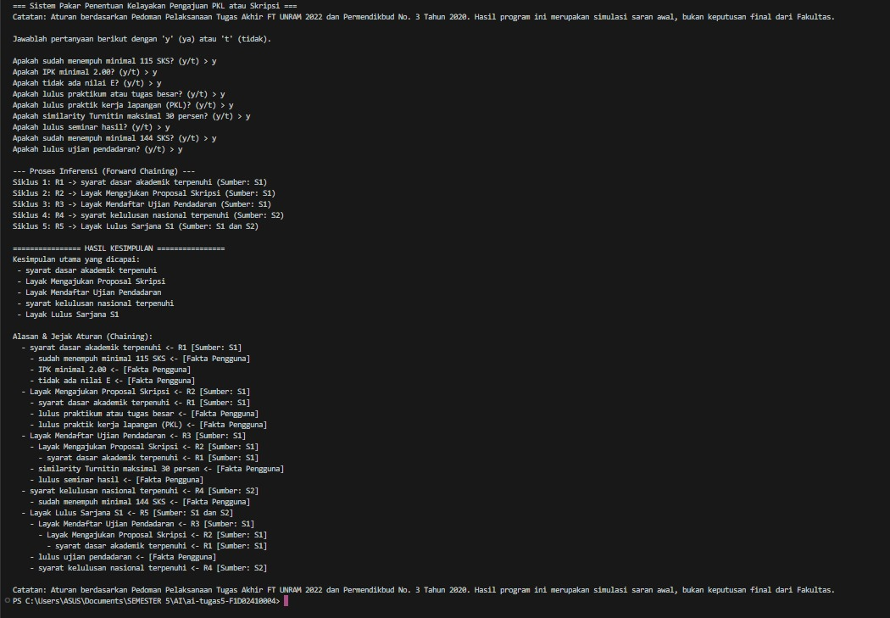
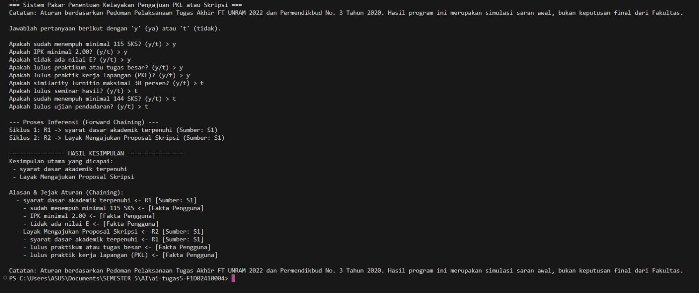
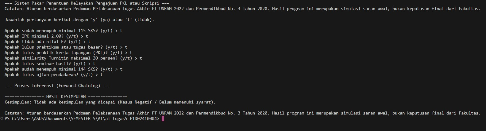

# Sistem Pakar Penentuan Kelayakan Pengajuan PKL dan Skripsi (Forward Chaining)

Tugas ini berisi program simulasi sistem pakar berbasis Python untuk menentukan kelayakan mahasiswa program sarjana (S1) Teknik Informatika dalam mengambil tahapan akademik (Pengajuan Proposal, Ujian Pendadaran, hingga Kelulusan Sarjana). 

---

## 1. Identitas Mahasiswa
* **Nama:** Deswita Salsabila
* **NIM:** F1D02410004

---

## 2. Topik & Cara Menjalankan Program
### A. Topik Sistem Pakar
Sistem pakar ini dirancang untuk melakukan simulasi pengecekan kelayakan mahasiswa tingkat akhir berdasarkan aturan akademik resmi. Program menanyakan serangkaian fakta dasar kepada pengguna (seperti status SKS, IPK, nilai mata kuliah, PKL, hingga hasil Turnitin), lalu melakukan proses inferensi untuk memberikan kesimpulan tahapan akademik yang dapat dicapai.

### B. Cara Menjalankan Program
1. Pastikan perangkat Anda sudah terinstal **Python**.
2. Pastikan file `main.py` dan `kb_kelayakan.json` berada di dalam satu folder yang sama.
3. Buka terminal atau Command Prompt (CMD) di direktori folder tersebut.
4. Jalankan program dengan perintah berikut:
   ```bash
   python main.py

---

## 3. Daftar Sumber & Tabel Aturan 

Basis pengetahuan pada file \`kb_kelayakan.json\` diturunkan dari dua sumber resmi:
1. **S1:** Pedoman Pelaksanaan Proyek Tugas Akhir Fakultas Teknik Universitas Mataram (FT UNRAM 2022). (https://ft.unram.ac.id/id/academic-guidance/)
2. **S2:** Permendikbud No. 3 Tahun 2020 tentang Standar Nasional Pendidikan Tinggi. (https://peraturan.bpk.go.id/Details/163703/permendikbud-no-3-tahun-2020)

### Tabel Aturan (Rule Base)
| ID Aturan | Premis (IF) | Konklusi (THEN) | Sumber |
| :--- | :--- | :--- | :--- |
| **R1** | sudah menempuh minimal 115 SKS, IPK minimal 2.00, tidak ada nilai E | syarat dasar akademik terpenuhi | S1 |
| **R2** | syarat dasar akademik terpenuhi, lulus praktikum atau tugas besar, lulus praktik kerja lapangan (PKL) | Layak Mengajukan Proposal Skripsi | S1 |
| **R3** | Layak Mengajukan Proposal Skripsi, similarity Turnitin maksimal 30 persen, lulus seminar hasil | Layak Mendaftar Ujian Pendadaran | S1 |
| **R4** | sudah menempuh minimal 144 SKS, IPK minimal 2.00 | syarat kelulusan nasional terpenuhi | S2 |
| **R5** | Layak Mendaftar Ujian Pendadaran, lulus ujian pendadaran, syarat kelulusan nasional terpenuhi | Layak Lulus Sarjana S1 | S1 dan S2 |

---

## 4. Metode yang Dipilih
Metode yang digunakan adalah **Forward Chaining** (Pelacakan Maju). Metode ini bekerja dengan cara mencocokkan fakta-fakta awal yang dimasukkan oleh pengguna dengan kondisi *IF* pada basis aturan (*rule base*). Jika kondisi terpenuhi, aturan akan menembakkan (*fire*) konklusi baru ke dalam memori kerja (*working memory*) hingga tidak ada lagi aturan baru yang dapat diaktifkan.

---

## 5. Tiga kasus uji dan *Screenshot*

Program telah diuji melalui 3 skenario berbeda:

### A. Kasus 1: Berhasil Penuh (Layak Lulus Sarjana S1)
Semua syarat terpenuhi (menjawab `y` pada seluruh pertanyaan).
* **Screenshot:** \`screenshot/kasus1 berhasil.png\`


### B. Kasus 2: Berhasil Sebagian (Tahap Proposal)
Memenuhi syarat akademik dasar dan PKL (Layak Mengajukan Proposal), namun belum memenuhi syarat pendadaran/akhir.
* **Screenshot:** \`screenshot/kasus-sebagian.png\`


### C. Kasus 3: Kasus Negatif / Gagal
Sebagian besar syarat utama tidak terpenuhi (menjawab `t`), sehingga program berhenti tanpa mencapai kesimpulan akhir.
* **Screenshot:** \`screenshot/kasus-gagal.png\`


---

## 6. Batas Keberlakuan (Disclaimer)
> Aturan berdasarkan Pedoman Pelaksanaan Tugas Akhir FT UNRAM 2022 dan Permendikbud No. 3 Tahun 2020. Hasil program ini merupakan simulasi saran awal, bukan keputusan final dari Fakultas.

---

## 7. Penggunaan Alat Bantu AI
Dalam proses pembuatan program ini, AI dimanfaatkan sebagai sarana asistensi untuk membantu penulisan kode, pengecekan *bug*, serta merapikan tampilan teks di terminal agar lebih rapi.